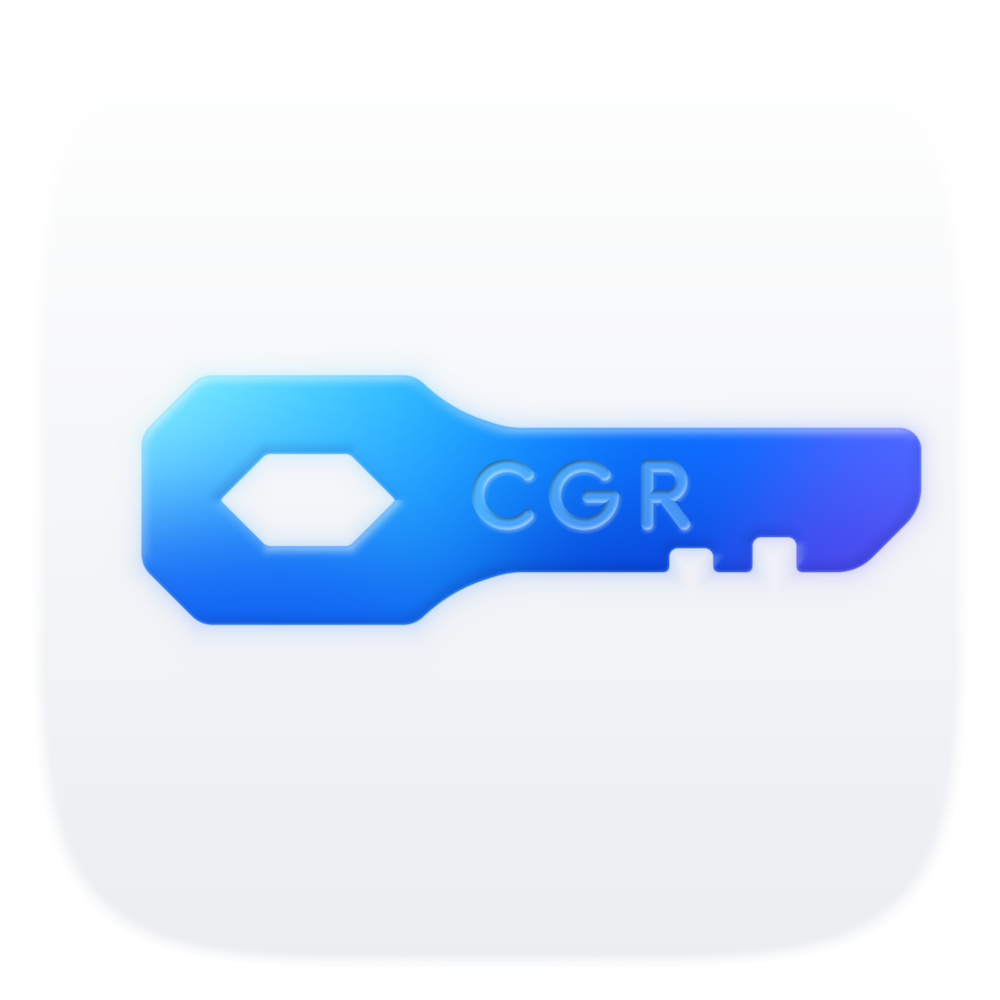

<p align="center"></p>

# Chirographe

Unforgeable, non-duplicable digital tokens, without a blockchain. Each token is held by its owner, and a group of guardians guarantees that each of its states is spent only once.

- [PROTOCOL.md](PROTOCOL.md): the protocol specification.
- [packages/core](packages/core): the reference implementation, `@chirographe/core`.
- [brand](brand): the logo, generated from one source.

## Development

Node 20+ and pnpm.

```sh
pnpm install
pnpm test
pnpm typecheck
pnpm lint
pnpm brand
```
